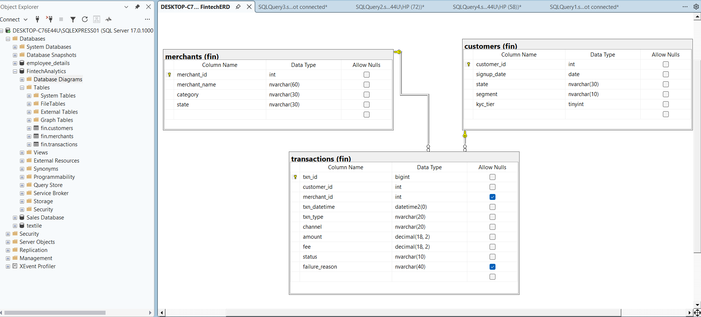

# Fintech Transaction Analytics (SQL Server / T-SQL)

An SQL project that analyses a synthetic digital wallet and payments platform modelled on Nigerian
fintechs: 5,000 customers,
299 merchants and 500,150 transactions over 24 months (July 2024 to June 2026).
Built in SQL Server (SSMS) with T-SQL.

> All data is synthetic and generated by script. No real customers, banks or fintechs are represented.

## Business context
The platform in this project is fictional, but its design is modelled on the kind of Nigerian
digital wallet and payments companies that operate today, such as OPay, Moniepoint and PalmPay.
I used their publicly visible features as a guide to make the data realistic:

| Feature of the platform | What it models |
|---|---|
| Channels: mobile app, USSD, web, POS, ATM | Customers reaching the platform from smartphones, basic phones, agents and card terminals |
| Transaction types: transfers, airtime, bill payments, POS, cash-in, withdrawals | The everyday services of a wallet or digital bank |
| Merchants in categories such as pharmacy, fuel and restaurants | Businesses accepting payments |
| Retail and SME customer segments | Individuals and small businesses on the same platform |
| KYC tiers 1 to 3 | Account limits that depend on how much verification a customer has completed |
| Fees on transfers and ATM withdrawals | Fee bands based on typical Nigerian transfer charges (₦10, ₦25, ₦50 plus 7.5% VAT) |

> **Disclaimer:** this project is not affiliated with any of these companies and uses none of their data.
> The names are mentioned only to show the type of business the project is modelled on.

You are the data analyst at this payments company. Leadership wants to know:

1. How is the platform growing?
2. Where do payments fail?
3. Do customers stay?
4. Is anything suspicious happening?

## Project files
| File | What it does |
|---|---|
| `generate_data.py` | Generates the three CSV files (fixed seed, so every run gives identical data) |
| `01_create_schema.sql` | Creates the `FintechAnalytics` database, the `fin` schema and 3 tables |
| `02_data_quality_checks.sql` | Checks the imported data before analysis |
| `03_analysis_queries.sql` | The business questions answered in T-SQL, with line-by-line comments |
| `04_performance_tuning.sql` | Execution plans and index experiments |

Run order: `01_create_schema.sql`, then import the three CSVs (see the workflow below), then `02`, `03` and `04`.

Requires SQL Server 2016 or newer. Developed on SQL Server 2025 Express with SSMS.
`transactions.csv` is about 35 MB and is not committed: run `python generate_data.py`
(needs pandas and numpy) to create `customers.csv`, `merchants.csv` and `transactions.csv`.

## Project workflow

### 1. Create the schema (`01_create_schema.sql`)
A schema is a sub-folder inside a database. All of the project's tables live in the `fin` schema.
The script runs these steps in order:

1. Check whether the database exists
2. Create the database
3. Set the recovery model
4. Run all following commands inside the new database
5. Check whether the `fin` schema already exists
6. Create the schema
7. Drop any old versions of the tables, so the script can be re-run safely
8. Create the tables

### 2. Import the data
Right-click the database, then Tasks, then Import Data, and choose the CSV (flat file) as the source.
Load `customers.csv` and `merchants.csv` first, then `transactions.csv`, because transactions
reference the other two through foreign keys.

> **Note:** when importing `transactions.csv` into `fin.transactions`, the `txn_datetime` column did not
> parse. I changed its source data type to `DT_DBTIMESTAMP2`, which keeps full date-time precision.

### 3. Validate the data before analysing it (`02_data_quality_checks.sql`)
An audit and integrity check of the loaded data:

| Check | Result |
|---|---|
| Row counts | 5,000 customers, 299 merchants, 500,150 transactions |
| Date range | 1 Jul 2024 to 30 Jun 2026 |
| Duplicate transaction IDs | None |
| Transactions dated before the customer signed up | None |
| Failed or reversed transactions that still charged a fee | None |
| Transaction types linked to a merchant | POS and bill payments always have a merchant; no other type does |
| Reasons behind transactions | Every failed transaction has a failure reason; no successful transaction has one |
| Status mix | 91.17% success, 6.82% failed, 2.01% reversed |
| Ten largest successful transactions (anti-money-laundering review) | All are the same amount, ₦157,569 (cash-ins and ATM withdrawals), which points to a ceiling in the generated amounts |

## Data model

- `fin.customers`: customer_id, signup_date, state, segment (Retail/SME), kyc_tier
- `fin.merchants`: merchant_id, merchant_name, category, state
- `fin.transactions`: txn_id, customer_id, merchant_id, txn_datetime, txn_type, channel, amount, fee, status, failure_reason

`fin.transactions` links to `fin.customers` and `fin.merchants` through foreign keys.
`merchant_id` and `failure_reason` are nullable by design, since only POS and bill payments carry a
merchant and only failed transactions carry a reason.

## Questions answered (`03_analysis_queries.sql`)
1. Month-on-month growth in transaction value
2. Which channel fails the most?
3. Top 3 merchants by value in each category
4. Anomaly detection: which days had a failure rate far above normal?
5. Velocity check: customers who made 10+ successful transfers within 15 minutes
6. Cohort retention: of the customers who signed up in a month, what percentage stay active over the next 6 months?
7. How much fee revenue does each segment and transaction type generate per month?

## Findings
Figures cover successful transactions, except findings 2 and 4, which are about failures and use all
transactions. Each finding says what I found and what the business should do about it.

### 1. Month-on-month growth
**What I found:** The highest growth came from July to August 2024: transaction value rose 180.62%
(₦43.8M to ₦122.8M, so August was about 2.8 times July). Growth then dropped to 52.85% in September and
23.6% in October, and stayed mostly in single digits through 2025. The last two months of the data
(May and June 2026) show a sharp jump, which comes from how the synthetic activity was generated and
should not be read as real growth.

**What the business should do:** Early growth came from a very small base. Track growth next to new-customer
sign-ups, so it is clear whether growth comes from acquiring customers or from existing customers
transacting more.

### 2. Which channel fails the most?
**What I found:** USSD fails the most. Failure rates were USSD 10.91% (14,775 of 135,413 transactions),
ATM 7.71%, mobile app 5.08%, web 5.04% and POS 5.00%. USSD fails about twice as often as the app, web or POS,
and it carries 27% of all transactions.

**What the business should do:** Treat USSD reliability as the first fix, because it combines the highest
failure rate with a large share of volume. Break its failures down by reason and work with the telco or
switch partner, and consider steering high-value transfers to the app.

### 3. Top 3 merchants by value in each category
**What I found:** Pharmacy was the highest-value category at ₦493.0M, ahead of Restaurants (₦466.3M) and
Fuel (₦458.8M). The single largest merchant is Ola Pharmacy 1 (₦58.7M), about 2.7 times the next pharmacy
(Metro Pharmacy 7, ₦22.0M). In every category the top merchant clearly leads the second: Zenith Eatery 2
(₦36.6M) against Delta Eatery 8 (₦20.9M) in Restaurants, for example.

**What the business should do:** Value is concentrated in a few merchants. Give them dedicated account
management and monitor them, because losing one would cost far more than losing an average merchant.

### 4. Anomaly detection: which days had a failure rate far above normal?
**What I found:** A z-score tells how many standard deviations a day's failure rate sits from the mean of
the previous 7 days. One day stands out: **14 March 2026**, with a 20.48% failure rate against a prior
7-day average of 6.63% (z-score 10.13, on 962 transactions). The next-highest days score only around 5.
A follow-up query on that day's failure reasons shows that 78.7% of the 197 failed transactions were
"Issuer or switch inoperative", against roughly a fifth on a normal day. That points to an outage on the
issuer or switch side, not a customer problem.

**What the business should do:** Automate this check as a daily alert, investigate days with a large
z-score first, and ask the switch provider about the 14 March outage. A minimum-volume filter would cut
false alarms on quiet days.

### 5. Velocity check: 10+ successful transfers within 15 minutes
**What I found:** Five accounts (customers 4000 to 4004) were flagged. On 20 May 2026, between 02:10:00
and 02:19:40, each sent 30 transfers (150 in total, about ₦7.4M), with amounts of about ₦48,500 to ₦49,900, just
under ₦50,000 (the flagged transfers ranged from ₦48,512 to ₦49,881). All five accounts started and finished at the same moments, one transfer
each every 20 seconds, which looks like a script and not human behaviour. The amounts may be an attempt to
stay below a ₦50,000 per-transaction limit, a pattern used to avoid being caught. The flagged accounts
span KYC tiers 1, 2 and 3, so the pattern is the threshold and not the account tier.

**What the business should do:** Add a velocity rule that holds and reviews customers who make 10 or more
transfers in 15 minutes, especially at night or just under a limit. This kind of check catches
automated bots, account takeovers and money laundering. Check the current per-transaction limits with
the compliance team before setting thresholds.

### 6. Cohort retention
**What I found:** Roughly 56% to 61% of customers are still transacting six months after signup (July 2024
cohort 56.1%, January 2025 cohort 60.2%, July 2025 cohort 60.7%). The first sharp drop comes between
month 2 and month 3: for example the July 2024 cohort falls from 87.2% to 73.0%, and the
January 2025 cohort from 93.4% to 76.3%. Month 0 is a partial month, because customers sign up
throughout it.

**What the business should do:** The first 90 days decide whether a customer stays. Target onboarding
messages and reactivation offers at customers before they reach month 3.

### 7. Fee revenue by segment and transaction type
**What I found:** Total fee revenue is ₦5.0M, of which transfers earn ₦3.90M (78%) and ATM withdrawals
₦1.10M (22%). Airtime, bill payments, cash-ins and POS earn no fee in this dataset. Retail transfers had
the most transactions in every one of the 24 months and the highest fee revenue each month. Retail
customers account for 85.7% of fee revenue, close to their 85.5% share of customers, so SMEs are not
generating more fee revenue per customer here.

**What the business should do:** Transfers are the revenue engine, so protect their reliability
(see the outage in finding 4). Airtime is about one in five transactions yet earns nothing, so review
whether a fee or commission is appropriate for high-volume free services.

## Key concepts (my notes)
- **CTE (Common Table Expression):** a temporary named result you define at the top of a query with the
  `WITH` keyword. It acts like a temporary virtual table that you write once and reference throughout the
  query. CTEs make queries reusable and readable.
- **Window function vs GROUP BY:** `GROUP BY` collapses rows, giving one summary row per group.
  A window function keeps every row and adds a new calculated column based on the surrounding rows
  (the "window").
- **Z-score and standard deviation:** standard deviation measures how spread out numbers are around
  their average. A low value means predictable data and a high value means unpredictable data.
  The z-score says how many standard deviations a value is from the mean.

## Skills demonstrated
T-SQL, schema design and data import, data validation, CTEs, joins, conditional aggregation, window
functions (`LAG`, `DENSE_RANK`, rolling `AVG` and `STDEV` over window frames), cohort analysis,
z-score anomaly detection, velocity (fraud) checks, writing commented, readable SQL, and turning query
results into business recommendations.

## About the data
The data is synthetic and was generated with `generate_data.py`. A few patterns were deliberately planted
so that the detection queries could be tested: an outage day, a burst of near-limit transfers,
higher USSD failure rates and early customer churn. This project shows the method for finding such
patterns, and the findings above should not be read as facts about any real company.
